<p align="center">
  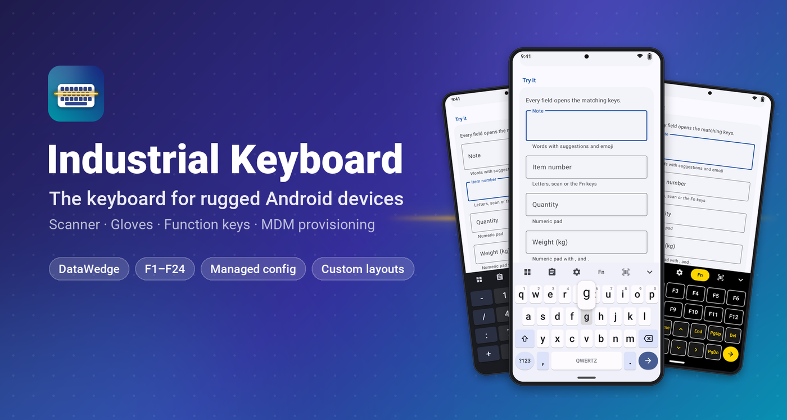
</p>

<p align="center">
  <a href="https://github.com/ict-baden/industrialkeyboard/releases/tag/latest"></a>
  
  
  
  
  
  
  
  
  
  <a href="https://github.com/ict-baden/industrialkeyboard/actions/workflows/build.yml"></a>
</p>

<p align="center">
  <b>Fast, reliable data entry on rugged Android devices.</b><br>
  Big keys for gloves, a scanner trigger built in, F1–F24 for terminal emulation – and the whole
  keyboard configurable from your MDM.
</p>

<p align="center">
  <a href="#-up-and-running-in-5-minutes">Quick start</a> ·
  <a href="docs/configuration.md">Configuration</a> ·
  <a href="docs/deployment.md">Deployment (SOTI, Intune, StageNow)</a> ·
  <a href="docs/integration.md">Scanner &amp; app integration</a> ·
  <a href="#limits-honestly">Limits</a>
</p>

> [!NOTE]
> **Deutsch:** Industrial Keyboard ist eine Bildschirmtastatur für robuste Android-Geräte (Zebra, Honeywell): große Tasten für Handschuhe, Scan-Taste, F1–F24 für Terminal-Emulation, zentral per MDM konfigurierbar. Kostenlos und Open Source (MIT), ohne Internetzugriff. Download: [IndustrialKeyboard.apk](https://github.com/ict-baden/industrialkeyboard/releases/download/latest/IndustrialKeyboard.apk). Die Oberfläche gibt es auf Englisch, Deutsch, Spanisch, Französisch und Chinesisch.

---

## ✨ What it looks like

<table>
  <tr>
    <td align="center">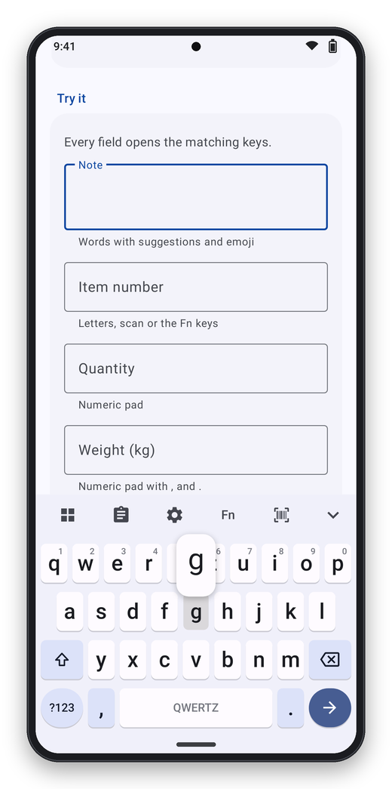<br><sub><b>Letters</b><br>Key preview above the finger</sub></td>
    <td align="center">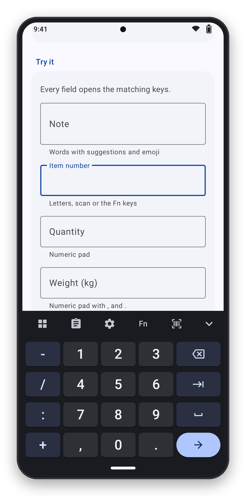<br><sub><b>Numeric pad</b><br>Opens by itself in number fields</sub></td>
    <td align="center">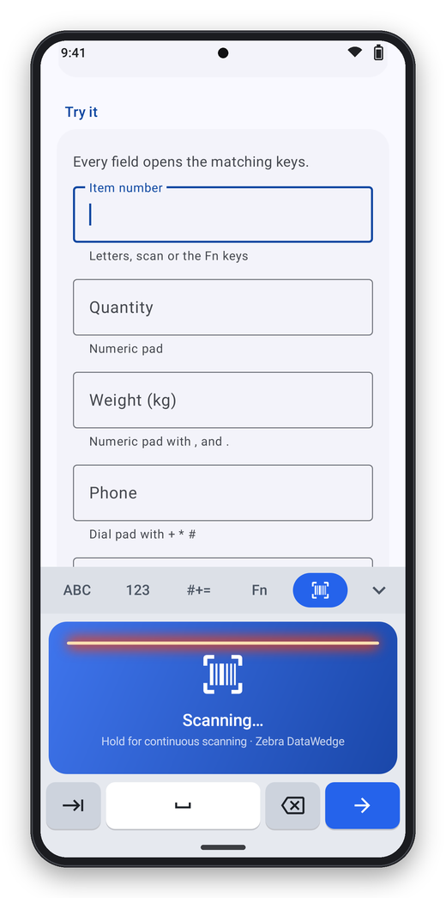<br><sub><b>Scan tab</b><br>Tap to scan, hold for continuous</sub></td>
    <td align="center">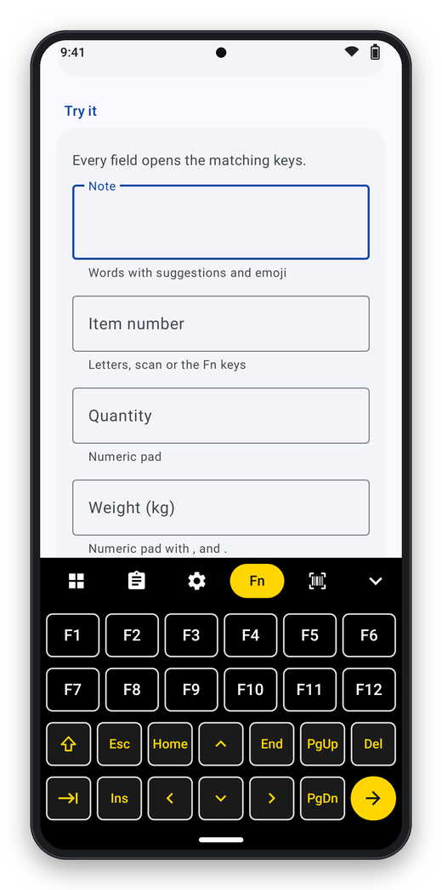<br><sub><b>Function keys</b><br>F1–F24, Esc, Ins, Del, arrows</sub></td>
  </tr>
  <tr>
    <td align="center">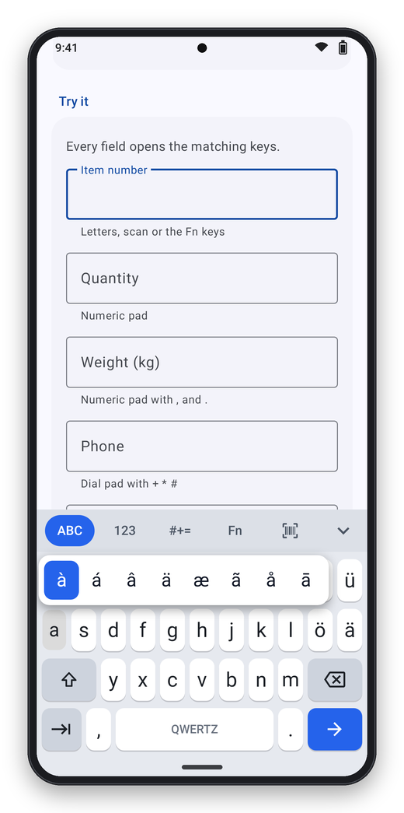<br><sub><b>Long press</b><br>Accents and special characters</sub></td>
    <td align="center">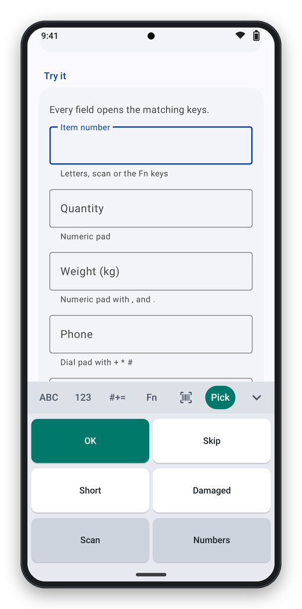<br><sub><b>Custom layouts</b><br>Your own keys as an extra tab</sub></td>
    <td align="center">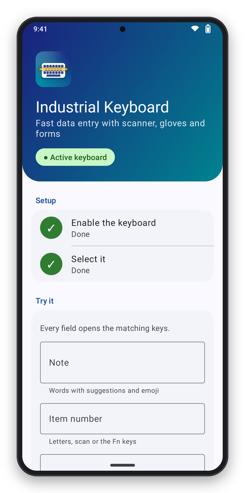<br><sub><b>Setup</b><br>Two steps and a test form</sub></td>
    <td align="center">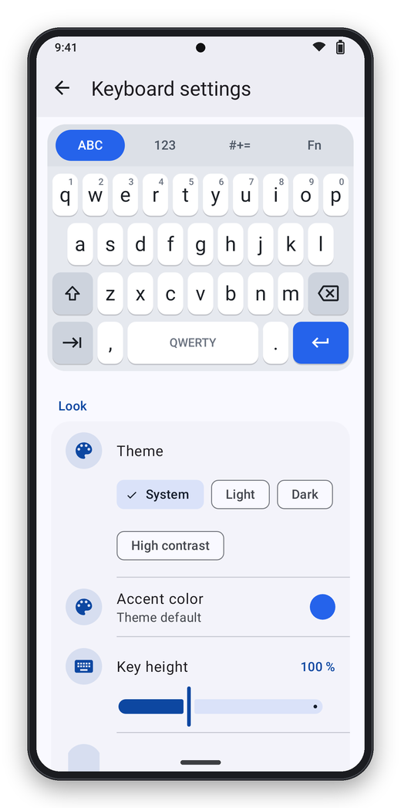<br><sub><b>Settings</b><br>Live preview, password protected</sub></td>
  </tr>
</table>

## 🚀 Features

| | |
|---|---|
| 🧤 **Made for gloves** | Key height 70–160 %, forgiving touch targets, preview bubble above the finger, rollover typing, high-contrast theme |
| 🔢 **The right keys for every field** | Number fields open the numeric pad (phone or calculator order, PIN, date, time), e-mail and URL fields get `@`, `/` and `.com`, Enter shows the field's action (next, search, send, done), auto-capitalization follows the field |
| 🔫 **Scanner built in** | Scan tab with a large trigger pad, optional scan key, soft trigger for Zebra DataWedge, Honeywell or any scanner app via intent. Scan results sent as a broadcast are typed with Enter or Tab |
| ⌨️ **Function keys** | Fn tab with F1–F12, **Shift for F13–F24**, Esc, Ins, Del, Home/End, PgUp/PgDn and arrows – plus an optional F1–F12 row above the letters |
| 🧩 **Programmable keys & macros** | Five free keys and custom layouts with macros such as `{TAB}`, `{F13}`, `OK{ENTER}`, `{SCAN}` or `{SHOW:numeric}` |
| 🗂️ **Custom layouts** | Your own keyboards (e.g. *OK / Skip / Damaged*) as extra tabs – defined in JSON, no app update needed |
| 🌍 **Alphabets** | QWERTY, QWERTZ, AZERTY, Nordic and Spanish, accents on long press, optional number row |
| 🎨 **Looks good** | Light, dark, high contrast or follow the system; custom accent color; smooth animations |
| 📡 **Central configuration** | Managed configuration (SOTI, Intune, Workspace ONE …), configuration file (also Zebra `/enterprise/usr`), broadcast intent (StageNow), admin password |
| 🔒 **Private by design** | No internet permission, no dictionary, nothing you type is stored or learned; configuration excluded from backups |

## ⚡ Up and running in 5 minutes

**1. Install the app** – download the APK from the [releases](../../releases/latest) and distribute it with your MDM, or install it over USB:

```bash
adb install -r IndustrialKeyboard-2.0.0.apk
```

**2. Switch it on** – open *Industrial Keyboard* on the device, tap **Enable** and **Select**. Over USB:

```bash
adb shell ime enable de.ictbaden.industrialkeyboard/.ime.KeyboardService
adb shell ime set de.ictbaden.industrialkeyboard/.ime.KeyboardService
```

For a whole fleet (Zebra MX, Android Enterprise policies) see [Deployment](docs/deployment.md#make-it-the-keyboard).

**3. Try it** – the setup screen has a test form: item number, quantity, weight, phone,
best-before date, PIN and e-mail. Every field opens the matching keys.

**4. Configure** – start from a template in [`examples/`](examples):

| Template | Use case |
|---|---|
| [`minimal.json`](examples/minimal.json) | German QWERTZ letters, everything else default |
| [`warehouse-gloves.json`](examples/warehouse-gloves.json) | High contrast, 135 % keys, calculator pad, scan key, sound and vibration, admin password (change it!) |
| [`terminal-emulation.json`](examples/terminal-emulation.json) | Dark theme, F-key row, Esc key and a *Host* tab with F13–F24, *Field exit* and *Reset* |
| [`custom-layout.json`](examples/custom-layout.json) | A *Pick* tab with OK / Skip / Short / Damaged / Scan / Numbers |
| [`classic-keys.json`](examples/classic-keys.json) | No tab bar: `?123` / `ABC` keys, AZERTY with number row, DataWedge trigger |

Deploy it as managed configuration (key `config_json`), as a file or as a broadcast – over USB:

```bash
adb push examples/warehouse-gloves.json /data/local/tmp/keyboard.json
adb shell 'am broadcast -a de.ictbaden.industrialkeyboard.action.INSTALL_CONFIG -n de.ictbaden.industrialkeyboard/.api.ApiReceiver --es config "$(cat /data/local/tmp/keyboard.json)"'
```

All options, including step by step for **SOTI MobiControl**: [Deployment](docs/deployment.md).

## ⌨️ Function keys

<p align="center">
  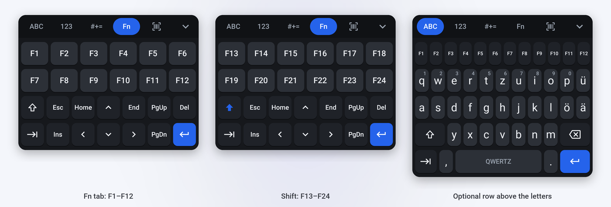
</p>

The **Fn** tab holds F1–F12, Esc, Ins, Del, Home, End, PgUp, PgDn and the arrow keys. **Shift**
turns the top rows into **F13–F24** for one key (double tap: until you tap Shift again).
Android has no key codes above F12, so F13–F24 are sent as Shift + F1…F12 – the mapping 5250
terminal emulators use. Prefer the keys always in
view? Switch on the **function key row** above the letters (`appearance.functionRow`). Every
key is also available as a macro: `{F1}` … `{F24}`, `{ESC}`, `{PGDN}`, …

## 🎨 Themes

<p align="center">
  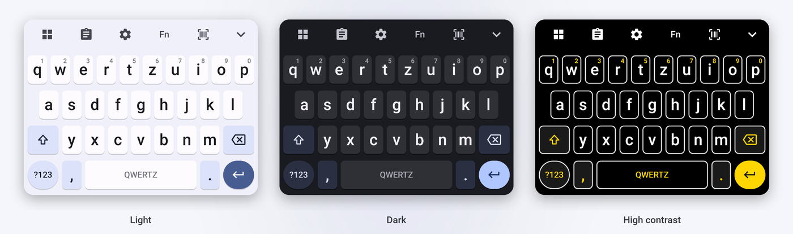
</p>

```json
{ "appearance": { "theme": "contrast", "accentColor": "#FFD600", "keyHeight": 130 } }
```

## 🔫 Scanning

- **Scan tab and scan key** – tap to read one barcode, hold for continuous scanning. The
  keyboard pulls the scanner's soft trigger: Zebra DataWedge and Honeywell are detected
  automatically, any other scanner app can be triggered with an intent.
- **Scan results** – the scanner usually types the barcode itself (keystroke output). If your
  scanner can send a broadcast instead, point it at the keyboard and it types the data into the
  focused field, followed by Enter or Tab.

Details and a DataWedge example: [Scanner & app integration](docs/integration.md).

## 🧩 Custom layouts

```json
{
  "customLayouts": [{
    "id": "picking",
    "label": "Pick",
    "rows": [
      [{ "label": "OK", "output": "OK{ENTER}", "width": 2, "style": "accent" }, { "label": "Skip", "output": "SKIP{ENTER}", "width": 2 }],
      [{ "label": "Scan", "output": "{SCAN}", "width": 2, "style": "function" }, { "label": "Numbers", "output": "{SHOW:numeric}", "width": 2 }]
    ]
  }]
}
```

Each layout becomes a tab next to *ABC*, *123* and *Fn*; other apps can open it with an intent.
Reference: [Configuration](docs/configuration.md#custom-layouts).

## 🛠️ Building

Requirements: JDK 17–21 and the Android SDK (compile SDK 37).

```bash
./gradlew testDebugUnitTest assembleDebug lintDebug
```

The APK lands in `app/build/outputs/apk/debug/`. Debug builds have the package
`de.ictbaden.industrialkeyboard.debug`, so they install next to the release build. Releases are
built and signed by the [CI](.github/workflows/build.yml): every push to `main` updates the
release [`latest`](https://github.com/ict-baden/industrialkeyboard/releases/tag/latest), a tag
`vX.Y.Z` creates a versioned release with `SHA256SUMS.txt`. The images in `docs/images` are rendered from
the real keyboard code – see [tools/screenshots](tools/screenshots/README.md).

## 📚 Documentation

- [Configuration](docs/configuration.md) – every option of the JSON format, macros, custom layouts
- [Deployment](docs/deployment.md) – install, make it the keyboard, managed configuration, files, StageNow
- [Scanner & app integration](docs/integration.md) – soft trigger, scan broadcasts, intent API
- [Data and privacy](docs/data-and-privacy.md) – what is stored where, which broadcasts the keyboard sends and receives
- [Error codes](docs/error-codes.md) – codes shown next to error messages, the same in every language
- [Changelog](CHANGELOG.md)

## Limits, honestly

- Tested on Zebra devices with DataWedge (HC20, Android 15). The **Honeywell** soft trigger is implemented after the vendor documentation but not yet tested on a Honeywell device.
- The keys are drawn on a canvas: **TalkBack** cannot read them.
- User interface in **English** only.
- No word prediction, no dictionary, no voice input – on purpose (nothing typed is stored).
- **Package changed** from `io.github.pieewiee.industrialkeyboard` to `de.ictbaden.industrialkeyboard`: Android treats it as a new app, see the [changelog](CHANGELOG.md).

---

<sub>
Industrial Keyboard is free and open source software by <b>ICT-Baden</b>. &nbsp;·&nbsp;
Licence: <a href="LICENSE">MIT</a> &nbsp;·&nbsp;
Third-party licences: <a href="THIRD-PARTY-NOTICES.txt">THIRD-PARTY-NOTICES.txt</a> &nbsp;·&nbsp;
Support: free via GitHub, guaranteed with a <a href="SUPPORT.md">support contract</a> &nbsp;·&nbsp;
<a href="SECURITY.md">Security</a> &nbsp;·&nbsp;
<a href="https://ict-baden.de/impressum">Impressum</a>
</sub>
