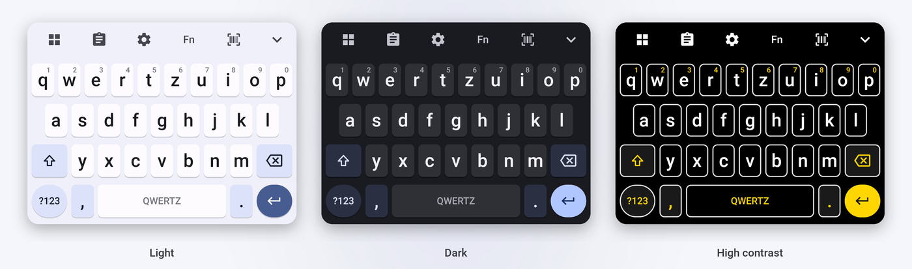
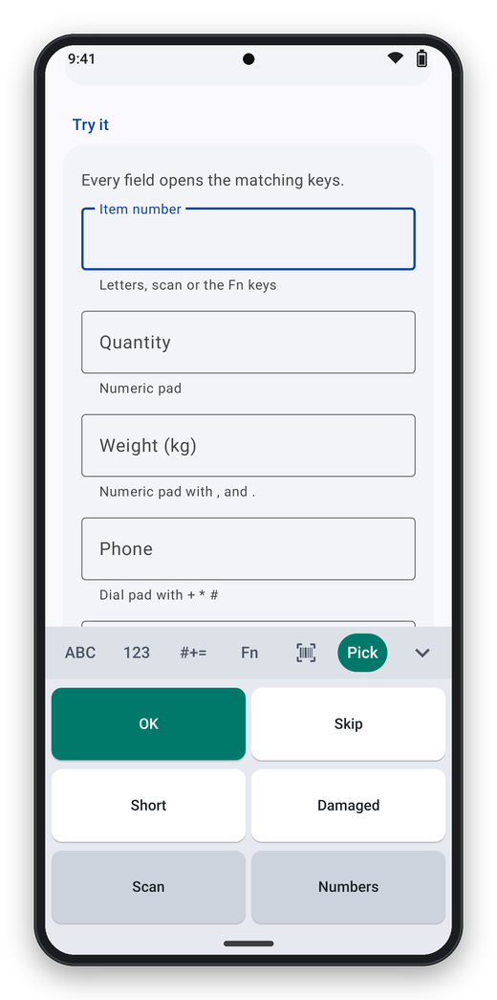

# Configuration

The whole keyboard is described by one JSON document. The same document works everywhere:
as managed configuration (`config_json`), as a file, as a broadcast, or imported in the app
(**Settings → Configuration → Import from file**). How to get it onto the devices:
[Deployment](deployment.md). Ready-made templates: [`examples/`](../examples).

- Every option is optional – missing options keep their defaults, `{}` is a valid configuration.
- A new configuration **replaces** the current one (including changes made in the settings).
  Only the admin password is kept when the new configuration does not set one.
- Mistakes are rejected as a whole with a precise message, e.g.
  `keys.numeric.p1: unknown token {TABB}` – the keyboard keeps working with its previous
  configuration. The last error is shown under **Settings → Configuration**.
- **Settings → Configuration → Export to file** writes the current configuration in exactly
  this format – a good starting point for your own.

## Order of precedence

The keyboard computes the configuration it works with when a field starts and when the
configuration changes – never per key. From lowest to highest:

1. **Stored configuration.** `config_json` from the MDM, a file, the `INSTALL_CONFIG` broadcast
   and **Import** replace it as a whole; the single options of the managed configuration and the
   admin settings change single values in it. Export and the QR code contain exactly this.
2. **Field rules**, which always win: number, phone and date fields open their pad; password
   fields get no suggestions, no autocorrection and no key preview.

The page that opens: a `SHOW_TAB` request or [`{SHOW:…}`](#macros) > the field type (number,
phone, date) > [`tabs.preferred`](#tabs).

## Complete example with all defaults

```json
{
  "version": 1,
  "language": "auto",
  "appearance": {
    "theme": "system",
    "keyHeight": 100,
    "width": 100,
    "numberRow": false,
    "functionRow": false,
    "keyHints": true,
    "modifierRow": false,
    "functionModifiers": false
  },
  "layout": {
    "alphabet": "auto",
    "navigation": "tabs",
    "numericOrder": "phone"
  },
  "tabs": {
    "alpha": true,
    "numeric": true,
    "symbols": true,
    "function": true,
    "scan": true,
    "preferred": "auto"
  },
  "keys": {
    "alpha.p1": "",
    "numeric.p1": "-",
    "numeric.p2": "/",
    "numeric.p3": ":",
    "numeric.p4": "+"
  },
  "typing": {
    "autoCapitalize": true,
    "doubleSpacePeriod": true,
    "longPressDelay": 300
  },
  "feedback": {
    "keyPopup": true,
    "sound": false,
    "vibrate": true
  },
  "scanner": {
    "trigger": "auto",
    "scanKey": false,
    "input": {
      "enabled": false,
      "action": "de.ictbaden.industrialkeyboard.action.SCAN_INPUT",
      "extra": "data",
      "suffix": "enter"
    },
    "camera": {
      "symbologies": [],
      "aim": "frame",
      "continuous": false,
      "duplicateDelayMs": 1500,
      "confirmReads": 1,
      "minLength": 0,
      "maxLength": 0,
      "zoom": 1.0,
      "torch": false,
      "inverted": true,
      "beep": true,
      "vibrate": true,
      "timeoutSeconds": 60
    },
    "data": {
      "prefix": "",
      "suffix": null,
      "trim": true,
      "removeSpaces": false,
      "case": "none",
      "stripLeading": 0,
      "stripTrailing": 0,
      "replace": [],
      "gs1": "hri",
      "gsReplacement": null,
      "rules": [],
      "unmatched": "send"
    },
    "ocr": {
      "enabled": true,
      "mode": "pick",
      "pattern": null,
      "startInOcr": false,
      "confirmReads": 2,
      "minLength": 0,
      "maxLength": 0,
      "charset": "any"
    },
    "nfc": {
      "enabled": true,
      "read": "ndefOrUid",
      "uidFormat": "hex",
      "uidReversed": false,
      "uidSeparator": "",
      "ndefRecord": "first",
      "beep": true,
      "vibrate": true
    }
  }
}
```

`version` is `1`. A configuration with a higher version is rejected, so an old app never
misreads a newer file.

## `language`

Language of the setup and settings screens and of the scan pad:

| Value | Language |
|---|---|
| `auto` (default) | Follows the device; English if the device language is not one of the five |
| `en` | English |
| `de` | German |
| `es` | Spanish |
| `fr` | French |
| `zh-Hans` | Chinese (simplified) |

Also selectable on the device under **Settings → Look → Language**, and as the single option
`language` of the managed configuration. The letter layout is a separate option
([`layout.alphabet`](#layout)). Error messages carry a code (`IK-0101` …) that is the same in
every language: [Error codes](error-codes.md).

## `appearance`

| Option | Values | Default | Effect |
|---|---|---|---|
| `theme` | `system`, `light`, `dark`, `contrast` | `system` | `system` follows the device's dark mode. `contrast`: black keys with white outlines and yellow highlights, for bright sunlight and low vision |
| `accentColor` | `#RRGGBB` or `#AARRGGBB` | blue `#2563EB`, yellow `#FFD600` in `contrast` | Selected tab, Enter key, Shift, scan pad and highlights |
| `dynamicColor` | `true` / `false` | `true` | Android 12+: system colours from the wallpaper (Material You) like Gboard, as long as `accentColor` is not set; not for `contrast` |
| `emojiKey` | `true` / `false` | `true` | 😊 between comma and space bar in normal text fields (not in passwords, e-mail and web addresses, numbers); opens the emoji panel with categories and skin tones, **ABC** returns. Recently used emoji are kept in memory only; the picker remembers the chosen skin tone per emoji on the device |
| `oneHanded` | `off`, `left`, `right` | `off` | One-handed mode like Gboard: the keys about 80 % wide at that side; the free side shows ⇄ (other side) and ⤢ (full width). Also from the toolbar ⊞ |
| `keyBorders` | `true` / `false` | `true` | Letter keys drawn as tiles. `false`: only the letters on the keyboard background, like Gboard with "Key borders" off. Enter and `?123` are pills like in Gboard either way |
| `keyHeight` | 70–160 (percent) | `100` | Row height; 100 % = 54 dp. Use 120–140 for gloves |
| `width` | 50–100 (percent) | `100` | Width of the keys, centered – for tablets and landscape |
| `numberRow` | `true` / `false` | `false` | Row with 1–0 above the letters |
| `functionRow` | `true` / `false` | `false` | Row with F1–F12 above the letters (and above the number row) |
| `keyHints` | `true` / `false` | `true` | Small digits on the top letter row – long press types them (only without number row) |
| `symbolHints` | `true` / `false` | `true` | Small symbols on the second and third letter row like Gboard ("Long press for symbols"): a @, s #, d € (or $ / £ by keyboard language), f _, g &, h -, j +, k (, l ), y *, x ", c ', v :, b ;, n !, m ?. A long press types the symbol first |
| `modifierRow` | `true` / `false` | `false` | Row with **Ctrl, Win, Alt**, Esc, Tab and Del above the letters (above the number and function rows) – for remote desktop and PC shortcuts, see [Ctrl, Win and Alt](#ctrl-win-and-alt) |
| `functionModifiers` | `true` / `false` | `false` | Extra row on the Fn tab with Ctrl, Win, Alt, Menu (context menu key), Print (Print Screen) and Pause (Alt+F4, Ctrl+Home …). All pages then get the height of five rows |

<p align="center"></p>

## `layout`

| Option | Values | Default | Effect |
|---|---|---|---|
| `alphabet` | `auto`, `qwerty`, `qwertz`, `azerty`, `nordic`, `spanish` | `auto` | Letter layout. `auto` follows the selected keyboard language (Android keyboard languages, switched with 🌐; before one is known: the first system language) (German, Czech, Swiss … → `qwertz`, French and Belgian → `azerty`, Swedish, Danish, Norwegian, Finnish → `nordic`, Spanish and Catalan → `spanish`, everything else `qwerty`) and changes with it. `qwertz` has ä ö ü ß first on long press (own keys with `umlautKeys`), `nordic` adds å ö ä, `spanish` ñ. Accents and special letters (ß, é, ç …) on long press |
| `topBar` | `toolbar`, `tabs` | `toolbar` | Above the keys while no word is typed. `toolbar` like Gboard: ⊞ (tiles for function keys, scan, number pad, clipboard, one-handed mode, languages, settings), 📋 clipboard, ⚙ settings, `Fn`, scan (with a scanner), custom layouts, 🎤 and hide; a second tap on `Fn`/scan goes back to the letters. `tabs`: ABC · 123 · #+= · Fn · Scan as up to 2.1. A configuration **stored** by 2.1 or older keeps `tabs`; new installations and files without the field get `toolbar`. Only with `navigation: "tabs"` |
| `symbolsKey` | `true` / `false` | `true` | `?123` key at the left of the bottom row like Gboard (`ABC` on the symbols page), also with `navigation: "tabs"`; with `"keys"` it is always there |
| `umlautKeys` | `true` / `false` | `false` | QWERTZ with ü, ö and ä as own keys (11 keys per row). Off: like Gboard, ä, ö, ü and ß come first on long press of a, o, u and s |
| `navigation` | `tabs`, `keys` | `tabs` | `tabs`: tab bar above the keys (ABC, 123, #+=, Fn, scan, custom layouts, hide button). `keys`: no tab bar, `?123` / `ABC` keys like a phone keyboard; on the numeric pad the last side key becomes `ABC`. Other pages are then reachable with [`{SHOW:…}`](#macros) on a programmable key |
| `numericOrder` | `phone`, `calculator` | `phone` | `phone`: 1-2-3 at the top. `calculator`: 7-8-9 at the top. Dial pads (phone number fields) always use phone order |

## `tabs`

| Option | Values | Default | Effect |
|---|---|---|---|
| `alpha`, `numeric`, `symbols`, `function`, `scan` | `true` / `false` | `true` | Show the tab. The scan tab only appears when a scanner is available ([`scanner.trigger`](#scanner)). If every tab is off, ABC stays |
| `preferred` | `auto`, `alpha`, `numeric`, `symbols`, `function`, `scan` or the id of a [custom layout](#custom-layouts) | `auto` | Page that opens in text fields. `auto` = letters |

The page always follows the field first: number, phone, date and time fields open the
numeric pad, whatever is configured here.

| Field (Android input type) | Opens |
|---|---|
| Text | `preferred` page; e-mail fields get `@` instead of `,`, URL fields `/` and `.com` on long press of `.` |
| Number, decimal, signed | Numeric pad with the programmable side keys |
| Number password (PIN) | Numeric pad without side keys |
| Phone | Dial pad with `+ * # -` |
| Date / time / date and time | Numeric pad with `/ - . ,` / `: . - ,` / `/ : - .` |

## `keys` – programmable keys

| Key | Position | Default |
|---|---|---|
| `alpha.p1` | Letters, bottom row, left of the comma | empty = no key (like Gboard); `{TAB}` up to 2.1 |
| `numeric.p1` … `numeric.p4` | Numeric pad, left column, top to bottom | `-` `/` `:` `+` |

The value is a [macro](#macros): text (`-`), keys (`{TAB}`), both (`OK{ENTER}`) or a command
(`{SCAN}`). The key shows the text, the key name (`F13`) or an icon (Tab, Scan, Enter …).
Phone, date and time fields show fixed keys instead of the numeric ones.

## `typing`

| Option | Values | Default | Effect |
|---|---|---|---|
| `autoCapitalize` | `true` / `false` | `true` | Capital letters where the field asks for them: sentence start, every word, or all capitals (item numbers) |
| `doubleSpacePeriod` | `true` / `false` | `true` | Two spaces after a word type `. ` |
| `longPressDelay` | 200–1500 (ms) | `300` (like Gboard; `400` up to 2.1) | Time until a long press shows the alternatives; 500–700 avoids accidental accents with gloves |
| `suggestions` | `true` / `false` | `true` | Three word suggestions above the keys while a word is typed, like Gboard: from a built-in dictionary of the keyboard language, best one in the middle; tap one to replace the word and add a space. In normal text fields and search fields (there without autocorrect) – never in passwords, e-mail and web addresses, numbers, dates or fields that set `textNoSuggestions` (barcode fields usually do). Nothing is learnt or stored |
| `autocorrect` | `true` / `false` | `true` (like Gboard) | Space replaces an obvious typo (one wrong, missing, extra or swapped letter) by the best suggestion; Backspace right after it brings the typed word back. Only in normal text fields with suggestions – never in fields that switch suggestions off (barcode and article number fields usually do); for pure data entry switch it off |
| `voice` | `auto`, `offline`, `off` | `auto` | Dictation inside the keyboard, like Gboard: the 🎤 in the tab bar (and at the right of the suggestions) replaces the keys with a listening panel; partial text appears in the field while speaking, the keyboard keeps listening until 🎤 is tapped again, ⌨ is pressed or 30 s pass without speech. Uses Android's speech recognition: `auto` = on-device recognition if the device has it (Android 12+, e.g. Pixel), otherwise the device's speech service, which may work online; `offline` = on-device recognition only (later also our own engine, issue #24); `off` = no microphone. Needs the microphone permission (asked on first use). Not in password fields. The old value `system` is read as `auto` |
| `nextWord` | `true` / `false` | `true` | After a space, three likely next words (`vielen ` → Dank, Grüße; `thank ` → you). From a small fixed list per language (German and English so far, `tools/dictionaries/next/`); the AOSP word lists have no word pairs and nothing is learnt from typing |
| `clipboardHistory` | `true` / `false` | `false` | Clipboard history for the toolbar's 📋 panel: text copied while the keyboard is shown, newest first, at most 20 entries, unpinned ones for 1 hour, **only in memory** (gone when the keyboard restarts). Never from password fields or clips marked sensitive. Off: the panel offers only what is copied right now |
| `deleteGesture` | `true` / `false` | `true` | Swipe left from Backspace marks whole words (one more per finger width), lifting the finger deletes them – like Gboard |

Always on: rollover typing with several fingers, key repeat on Backspace, Del and the arrow
keys, slide on the space bar to move the cursor, long press on the space bar to switch
keyboards, double tap on Shift for caps lock, long press on the hide button for the settings.

## `feedback`

| Option | Values | Default | Effect |
|---|---|---|---|
| `keyPopup` | `true` / `false` | `true` | Preview balloon above the pressed key, like Gboard (about 1.6 × the key height, shown on touch-down, gone on release); never in password fields (visible ones included) |
| `sound` | `true` / `false` | `false` | Click sound (independent of the system's touch sounds) |
| `soundVolume` | 0–100 | not set = default volume | Click volume |
| `vibrate` | `true` / `false` | `true` | Short vibration on every key |
| `vibrationMs` | 5–100 (ms) | not set = the system's keyboard haptic | Vibration length; 30–40 can be felt through gloves. Not set: the device's tuned keyboard tick, like Gboard |

## `scanner`

| Option | Values | Default | Effect |
|---|---|---|---|
| `trigger` | `auto`, `datawedge`, `honeywell`, `intent`, `camera`, `none` | `auto` | How the scan pad, the scan key and `{SCAN}` start the scanner. `auto`: the scan engine of the device if it has one (Zebra: DataWedge lists a built-in imager or laser or a connected Bluetooth/USB scanner; Honeywell: scanner service installed), otherwise the camera. `camera`: always the camera – its picture replaces the keys, the first code read is typed with `input.suffix`, the camera closes after the code, with ✕ or after one minute. Without a scanner and camera the scan tab and the scan key are hidden |
| `intentAction` | text | – | Broadcast action that starts a scan, for `trigger: "intent"` (required then) |
| `intentPackage` | text | – | Package that receives it (optional, recommended) |
| `scanKey` | `true` / `false` | `false` | Scan key in the bottom row of the letters, next to Enter |
| `input.enabled` | `true` / `false` | `false` | Type barcodes that a scanner app sends as broadcast. Not into password fields or `TYPE_NULL` fields. See the [security note](integration.md#option-b--the-keyboard-types-it) |
| `input.action` | text | `de.ictbaden.industrialkeyboard.action.SCAN_INPUT` | Broadcast action the keyboard listens to |
| `input.extra` | text | `data` | String extra with the barcode. Also checked: `com.symbol.datawedge.data_string`, `barcode_string`, `decode_string`, `com.honeywell.aidc.extra.EXTRA_DATA` |
| `input.suffix` | `none`, `enter`, `tab` | `enter` | Key after the barcode |
| `input.permission` | text | – | Permission the sending app must hold; Android delivers the broadcast only from apps that have it |
| `input.allowedPackages` | list of package names | – | Only these apps may send. Android 14+ and only senders that share their identity; with a list set, all others are refused |

How it works with DataWedge and other scanner apps: [Scanner & app integration](integration.md).

### `scanner.camera` – scanning with the camera

Only for the camera (`trigger: "camera"`, or `auto` on a device without scan engine). Aiming, barcode
types and decoders of a scan engine are set in DataWedge or the Honeywell settings, not here.

| Option | Values | Default | Effect |
|---|---|---|---|
| `symbologies` | list of [barcode types](#barcode-types) | `[]` | Codes the camera reads; empty = all |
| `aim` | `frame`, `center`, `anywhere` | `frame` | `frame`: only codes whose centre is inside the aiming frame. `center`: only the code under the crosshair in the middle – the pick list for labels with many codes. `anywhere`: the whole picture, the code nearest the middle wins |
| `continuous` | `true` / `false` | `false` | The camera stays open and types every new code (stock taking); the line under the frame counts them. Close with ✕ |
| `duplicateDelayMs` | 0–10000 | `1500` | Continuous mode: the same code counts again only after this time without seeing it |
| `confirmReads` | 1–3 | `1` | The same code has to be read in this many frames in a row – against misreads of damaged 1D codes |
| `minLength`, `maxLength` | 0–9999 | `0` | Accepted text length, `0` = no limit. Other codes are ignored and the camera keeps looking |
| `zoom` | 1.0–4.0 | `1.0` | Zoom when the camera opens. The button next to the torch switches 1× → 2× → 3× |
| `torch` | `true` / `false` | `false` | Torch on when the camera opens |
| `inverted` | `true` / `false` | `true` | Also light codes on a dark background |
| `beep`, `vibrate` | `true` / `false` | `true` | Beep and short vibration on every code |
| `timeoutSeconds` | 0–600 | `60` | The camera closes after this time without a code, `0` = never. In continuous mode the time starts again after each code |

### `scanner.data` – scan data formatting

Changes the barcode text before the keyboard types it, like the data formatting of scanner apps.
It applies to camera scans and to barcodes from `scanner.input` broadcasts. Barcodes that DataWedge
types itself (keystroke output) never pass through the keyboard – format those in DataWedge.

| Option | Values | Default | Effect |
|---|---|---|---|
| `prefix` | [macro](#macros) | `""` | Typed before the code, e.g. `{TAB}` or `LOC:` |
| `suffix` | [macro](#macros) or `null` | `null` | Typed after the code instead of `input.suffix`, e.g. `{TAB}{TAB}` or `{F5}`; `""` = nothing. `null` keeps `input.suffix` (Enter, Tab or nothing) |
| `trim` | `true` / `false` | `true` | Remove spaces and control characters at both ends (the GS separator stays) |
| `removeSpaces` | `true` / `false` | `false` | Remove all spaces |
| `case` | `none`, `upper`, `lower` | `none` | Upper or lower case |
| `stripLeading`, `stripTrailing` | 0–999 | `0` | Cut this many characters at the start / end, e.g. a check digit |
| `replace` | list of `{"find", "with", "regex"}` | `[]` | Replacements in this order. With `"regex": true`, `find` is a Java regular expression and `with` may use `$1` … |
| `gs1` | `hri`, `raw` | `hri` | Camera: GS1 codes (GS1-128, GS1 DataMatrix, GS1 QR) human readable as `(01)04012345678901(10)AB12`, or raw with the GS separator (U+001D) between variable-length fields |
| `gsReplacement` | [macro](#macros) or `null` | `null` | Typed in place of the GS separator in every code, e.g. `{TAB}`, `"|"` or `""` (remove); `null` = type the GS character itself |
| `rules` | list of rules | `[]` | Different formatting per barcode type or content, see below |
| `unmatched` | `send`, `drop` | `send` | With rules: what happens to a code that no rule matches – type it with the settings above, or ignore it |

The steps run in this order: trimming, cutting, removing spaces, replacements,
case, then prefix and suffix around the text; the GS replacement is typed while the text is typed.

**Rules.** The first rule that matches a code wins; every field it sets replaces the setting above
for that code. A rule matches when all its conditions hold:

| Field | Meaning |
|---|---|
| `name` | Free text, for you |
| `symbologies` | [Barcode types](#barcode-types); empty = all, also when the type is unknown (a broadcast without type) |
| `minLength`, `maxLength` | Length of the (trimmed) text, `0` = no limit |
| `startsWith` | Text the code starts with |
| `pattern` | Java regular expression that has to match the whole (trimmed) text |
| `action` | `send` (default) or `drop` – a dropped camera code is ignored and the camera keeps looking |
| `prefix`, `suffix`, `case`, `stripLeading`, `stripTrailing`, `removeSpaces`, `replace` | Same as above, for the codes of this rule |

The type of a broadcast is taken from DataWedge's `com.symbol.datawedge.label_type` or an AIM
identifier in `aimId` (Honeywell); the camera always knows it.

**Example: GTIN without the check digit, Code 128 as is.**

```json
"data": {
  "rules": [ { "name": "GTIN", "symbologies": ["ean13", "upca"], "stripTrailing": 1 } ]
}
```

**Example: accept only EAN-13**, everything else is ignored (the camera keeps looking):

```json
"camera": { "symbologies": ["ean13"] },
"data": { "rules": [ { "symbologies": ["ean13"] } ], "unmatched": "drop" }
```

**Example: GS1 fields separated by Tab.** Read GS1 codes raw and press Tab in place of every GS
separator, so for example the GTIN (`01…`) and the batch (`10…`) land in two form fields:

```json
"data": { "gs1": "raw", "gsReplacement": "{TAB}", "suffix": "{ENTER}" }
```

### `scanner.ocr` – text recognition (OCR)

Where the keyboard scans with the camera, its picture has a switch **Barcode | Text**. In text mode
the keyboard reads printed text instead of barcodes – serial numbers, batch numbers, best-before
dates, meter readings. Recognition is Google ML Kit (Latin script) and runs on the device; the
keyboard has no internet permission, so nothing can leave it.

| Field | Values | Default | Meaning |
|---|---|---|---|
| `enabled` | `true` / `false` | `true` | Offer the switch Barcode \| Text on the camera picture |
| `mode` | `pick`, `pattern` | `pick` | `pick`: the lines recognised inside the frame get boxes, tap one to type it. `pattern`: the first line inside the frame that fully matches `pattern` is typed automatically |
| `pattern` | Java regular expression or `null` | `null` | Required for `pattern`. The whole (cleaned) line has to match |
| `startInOcr` | `true` / `false` | `false` | The camera opens in text mode |
| `confirmReads` | 1–5 | `2` | `pattern` mode: the same text in this many pictures in a row before it counts (OCR mixes up single characters more often than a barcode decoder) |
| `minLength`, `maxLength` | 0–999 | `0` | Accepted line length, 0 = no limit |
| `charset` | `any`, `digits`, `alnum`, `upper` | `any` | Cleanup of each line before length and pattern: `digits` keeps 0–9 and `, . -`; `alnum` letters and digits; `upper` letters and digits in upper case |

The text then goes through [`scanner.data`](#scannerdata--scan-data-formatting) like a barcode, with
the type `ocr` – so rules can treat it differently (`"symbologies": ["ocr"]`). Continuous mode,
duplicate delay, beep and vibration of `scanner.camera` apply as well.

**Example: serial numbers like `AB123456` automatically.**

```json
"ocr": { "mode": "pattern", "pattern": "[A-Z]{2}\\d{6}", "charset": "upper" }
```

**Example: best-before date `31.12.2027`.**

```json
"ocr": { "mode": "pattern", "pattern": "\\d{2}\\.\\d{2}\\.\\d{4}", "startInOcr": true }
```

OCR depends on light and print quality more than barcodes do; see [Limitations](limitations.md).

### `scanner.nfc` – NFC tags

Hold an NFC tag (badge, container label, storage location) to the device while the keyboard is
open: its UID or the text stored on it is typed into the field.

| Field | Values | Default | Meaning |
|---|---|---|---|
| `enabled` | `true` / `false` | `true` | Type NFC tags (when the device has NFC and it is switched on) |
| `read` | `uid`, `ndef`, `ndefOrUid` | `ndefOrUid` | `uid`: the serial number of the chip. `ndef`: the text or URI stored on the tag (NDEF text, URI and `text/*` records). `ndefOrUid`: the stored text, the UID if there is none |
| `uidFormat` | `hex`, `decimal` | `hex` | UID as upper-case hex bytes or as an unsigned decimal number |
| `uidReversed` | `true` / `false` | `false` | Reverse the byte order – many badge readers show the UID reversed |
| `uidSeparator` | up to 4 characters | `""` | Between hex bytes, e.g. `":"` → `04:A2:3B:FF` |
| `ndefRecord` | `first`, `allLines` | `first` | The first text/URI record, or all of them one per line |
| `beep`, `vibrate` | `true` / `false` | `true` | Feedback when a tag was typed |

The value goes through [`scanner.data`](#scannerdata--scan-data-formatting) with the type `nfc`.

**Example: badge number as reversed decimal UID** (as printed by many access systems):

```json
"nfc": { "read": "uid", "uidFormat": "decimal", "uidReversed": true }
```

How it works: an input method cannot read tags itself (Android's reader mode needs an app screen in
front). Android hands the tag to a small invisible screen of the keyboard, which closes at once and
passes the value to the keyboard. When no field has the keyboard, the tag is ignored with a short
message. If several apps on the device handle NFC tags, Android may ask which one to use; choose
Industrial Keyboard with *Always* (or set it as default through the EMM). Apps that read tags
themselves while they are in front (reader mode) get the tag first.

### Barcode types

`aztec`, `codabar`, `code39`, `code93`, `code128` (also GS1-128), `databar`, `databarexpanded`,
`databarlimited`, `datamatrix`, `ean8`, `ean13`, `itf`, `maxicode`, `pdf417`, `micropdf417`, `qr`,
`microqr`, `rmqr`, `upca`, `upce`.

For [rules](#scannerdata--scan-data-formatting) there are also `ocr` (text from the camera) and
`nfc` (NFC tags); they are not camera barcode types and are ignored in `scanner.camera.symbologies`.

## Custom layouts

Your own keyboards, shown as extra tabs after the built-in ones:

```json
{
  "customLayouts": [
    {
      "id": "picking",
      "label": "Pick",
      "rows": [
        [ { "label": "OK", "output": "OK{ENTER}", "width": 2, "style": "accent" }, { "label": "Skip", "output": "SKIP{ENTER}", "width": 2 } ],
        [ { "label": "Short", "output": "SHORT{ENTER}", "width": 2 }, { "label": "Damaged", "output": "DMG{ENTER}", "width": 2 } ],
        [ { "label": "Scan", "output": "{SCAN}", "width": 2, "style": "function" }, { "label": "Numbers", "output": "{SHOW:numeric}", "width": 2, "style": "function" } ]
      ]
    }
  ]
}
```

<p align="center"></p>

| Option | Values | Effect |
|---|---|---|
| `id` | `a`–`z`, `0`–`9`, `-`, `_`, up to 24 characters | Unique name, used by `tabs.preferred`, `{SHOW:id}` and the `SHOW_TAB` intent. `auto`, `alpha`, `numeric`, `symbols`, `function` and `scan` are reserved |
| `label` | text | Tab label; default: the id in capitals |
| `rows` | array of rows, each an array of keys | The keys, top to bottom |

A key is either a **string** – a [macro](#macros); the key shows its text, key name or icon
(`"{F13}"`, `"Y{ENTER}"`, `"{TAB}"`) – or an **object**:

| Option | Values | Default | Effect |
|---|---|---|---|
| `label` | text | – | Text on the key |
| `output` | [macro](#macros) | the label | What the key types or does |
| `width` | 0.5–10 | `1` | Width relative to the other keys; shorter rows are centered |
| `style` | `normal`, `function`, `accent` | `normal` | Key color: normal, gray like Shift and Tab, or the accent color like Enter |

The rows share the height of the letter page, so a layout with three rows gets taller keys –
ideal for a handful of big buttons.

## Macros

Text with tokens in curly braces. Tokens are case-insensitive; unknown tokens are rejected
when the configuration is loaded.

| Kind | Tokens |
|---|---|
| Keys | `{TAB}` `{ENTER}` `{ESC}` `{BS}` (`{BACKSPACE}`) `{DEL}` (`{DELETE}`) `{INS}` (`{INSERT}`) `{HOME}` `{END}` `{PGUP}` (`{PAGE-UP}`) `{PGDN}` (`{PAGE-DOWN}`) `{UP}` `{DOWN}` `{LEFT}` `{RIGHT}` |
| Function keys | `{F1}` … `{F12}`, `{F13}` … `{F24}` (sent as Shift + F1 … F12) |
| Modifiers | `{CTRL}` (`{CONTROL}`), `{ALT}`, `{WIN}` (`{META}`) press the key alone (`{WIN}` opens the Start menu). A key whose whole macro is one of them becomes a sticky modifier key, like those of `modifierRow` |
| Key combinations | Modifiers and one key joined with `+`: `{CTRL+C}`, `{ALT+F4}`, `{WIN+R}`, `{CTRL+SHIFT+ESC}`, `{CTRL+ALT+END}`. Modifiers: `CTRL`, `ALT`, `WIN`, `SHIFT`; key: any key name above, `A`–`Z`, `0`–`9` or `SPACE` |
| More keys | `{PRINT}` (Print Screen), `{PAUSE}`, `{MENU}` (context menu key) |
| Characters | `{SPACE}`, `{LBRACE}` / `{OPEN-BRACE}` = `{`, `{RBRACE}` / `{CLOSE-BRACE}` = `}`, `{U+20AC}` or `{HEX:20AC}` = any Unicode character (here €) |
| Commands | `{SCAN}` start/stop the scanner, `{HIDE}` hide the keyboard, `{SETTINGS}` open the settings, `{NEXT-KEYBOARD}` switch to the next keyboard, `{SHOW:tab}` show a tab (`alpha`, `numeric`, `symbols`, `function`, `scan` or a custom layout id) |

`{ENTER}` behaves like the Enter key: it runs the field's action (next field, search, send …)
or starts a new line in multi-line fields.

Examples: `OK{ENTER}` · `{F13}` · `{TAB}{TAB}` · `{U+00E4}` · `{SHOW:picking}` · `{ESC}{F3}` · `{CTRL+C}` · `{WIN}notepad{ENTER}`

## Ctrl, Win and Alt

For remote desktop (Microsoft Remote Desktop / Windows App, RD clients, VNC, Citrix) and PC
shortcuts in web apps. There are three ways to get the keys – switch on what you need:

| Option | Where | How |
|---|---|---|
| Row above the letters | ABC tab | `appearance.modifierRow: true`, or *Settings → Appearance → Ctrl, Win and Alt row* |
| Row on the function keys | Fn tab | `appearance.functionModifiers: true`, or *Settings → Appearance → Ctrl, Win and Alt on Fn* |
| Own keys | programmable keys, custom layouts | `{CTRL}`, `{ALT}`, `{WIN}` as sticky keys, or fixed combinations such as `{CTRL+ALT+END}` |

The modifier keys are sticky, because you cannot hold two keys at once with gloves:

- **Tap** – the key lights up and applies to the next key: tap *Ctrl*, then *C* = Ctrl+C.
  Several modifiers combine (Ctrl, Alt, then Del). The modifiers stay on when you switch tabs, so
  *Alt* on the letters followed by *F4* on the Fn tab is Alt+F4.
- **Tap again** – presses the key alone (*Win* opens the Start menu, *Alt* the menu bar).
- **Shift** – a Shift you tap yourself also applies to Tab, the arrows, Esc, Del, Home/End and
  the other keys: Shift+Tab goes back a field, Shift+→ selects. Neither the automatic Shift at
  the start of a sentence nor Caps Lock does this, so Tab stays Tab while typing in capitals.
- **Hold** – locks the key (filled with the accent color) until you tap it again.

While a modifier is on, letters, digits and the US punctuation keys go out as key presses instead
of text, so the app sees Ctrl+C and not the letter c. Shift counts only when you tap it yourself,
not at the start of a sentence. Ctrl, Win and Alt are pressed and released around the key like on
a PC keyboard.

> [!TIP]
> Windows keeps Ctrl+Alt+Del for itself; in a remote session send **Ctrl+Alt+End**
> (`{CTRL+ALT+END}`). [`examples/remote-desktop.json`](../examples/remote-desktop.json) has a
> ready-made *RDP* tab with it, Alt+Tab, Win+R, Ctrl+C/V/Z and Alt+F4.

## Admin password

```json
{ "adminPassword": "change-me" }
```

- Protects the keyboard settings (asked when they are opened), configuration broadcasts
  (`INSTALL_CONFIG` needs the extra `password`; without a password broadcasts are only accepted on EMM-managed devices)
  and configuration files in the app folder (top-level `"password"`), see [Deployment](deployment.md#configuration-file).
- Stored only as a salted PBKDF2 hash; an export contains `adminPasswordHash` instead of the
  password, and importing that export keeps the same password.
- A configuration without `adminPassword` keeps the current password. Change or remove it in
  **Settings → Configuration → Admin password**; the managed configuration key
  `admin_password` sets it centrally.
